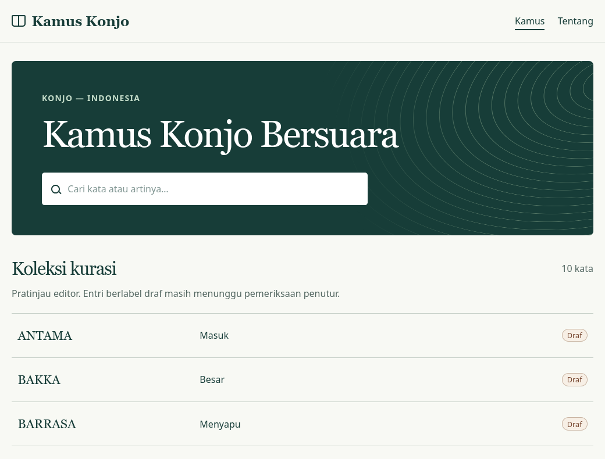

# Kamus Konjo Bersuara

Prototipe kamus Konjo–Indonesia dengan pencarian dua arah dan pelafalan dari penutur. Sepuluh entri awal dari proyek kuliah masih berstatus draf.

## Menjalankan di laptop

Gunakan Node.js 24 atau lebih baru. Jalankan `npm ci`, kemudian `npm run dev` dan buka alamat lokal yang dicetak Vite. Mode ini memuat draf untuk kurasi. Gunakan `npm test` untuk pengujian dan `npm run build` untuk membuat situs statis di `dist/`. Jalankan `npm run preview` untuk melihat hasil build. Koleksi publik akan kosong sampai ada entri terbit.

## Melengkapi kata pertama

Pilih entri dari `data/entri.json`. Catat ragam dan isi `contoh` dengan properti `konjo` dan `indonesia`. Setelah mendapat persetujuan penutur, letakkan rekaman MP3 di `public/audio/` dan isi `audio` dengan `berkas` (nama file, misalnya `k0001-01.mp3`) dan `kredit` (nama pilihan penutur). Gunakan huruf kecil, angka, tanda hubung, atau garis bawah pada nama file. Pertahankan ID saat memperbaiki ejaan. Ubah status menjadi `terbit` setelah penutur memeriksa isi dan menyetujui rekaman. Build menyalin rekaman yang dirujuk entri terbit saja.

Lihat [rencana kurasi dan target rilis](RENCANA.md).

## Lisensi kode dan sumber koleksi

Kode aplikasi dan dokumentasi teknis menggunakan [lisensi MIT](LICENSE). Sepuluh pasangan kata dan arti awal berasal dari kamus tugas kuliah Emil Rahmat yang juga berlisensi MIT. [Kode dan lisensi sumber](https://github.com/Emil-02/Rekayasa_Komputasional)

Untuk tambahan data dan rekaman, catat sumber, izin penggunaan, dan kredit per materi. Publikasi audio di kamus mengikuti persetujuan penutur. Penggunaan kembali rekaman mengikuti izin khusus rekaman tersebut.
